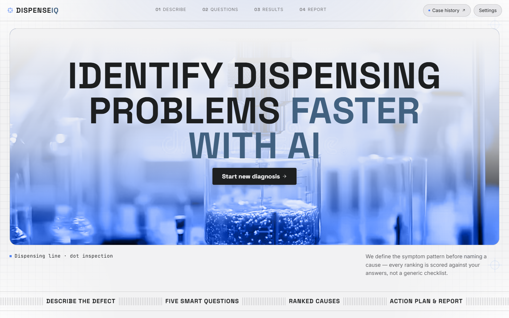
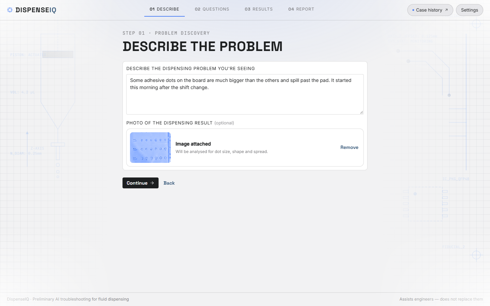
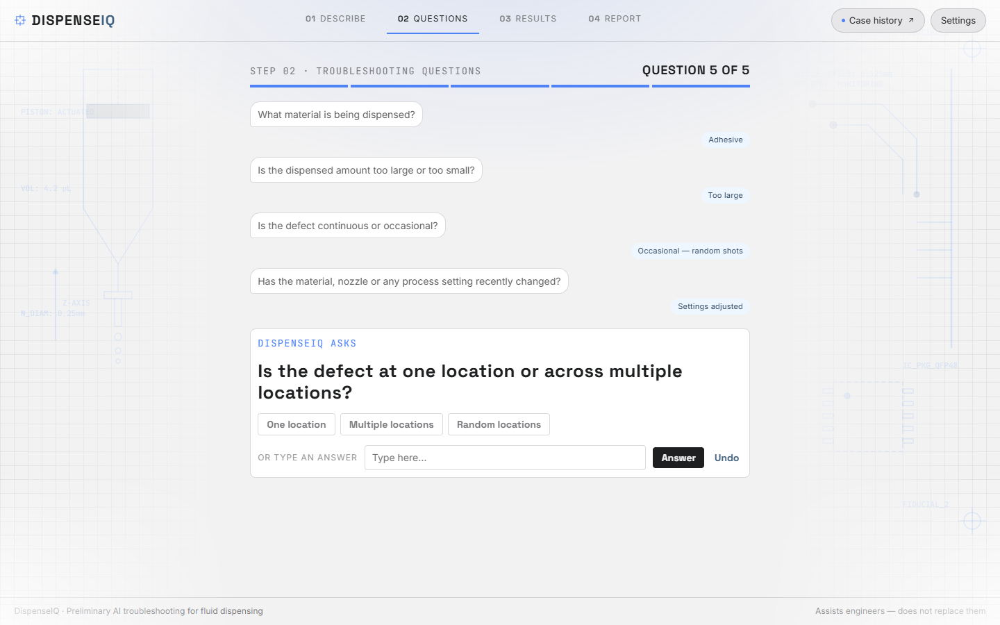
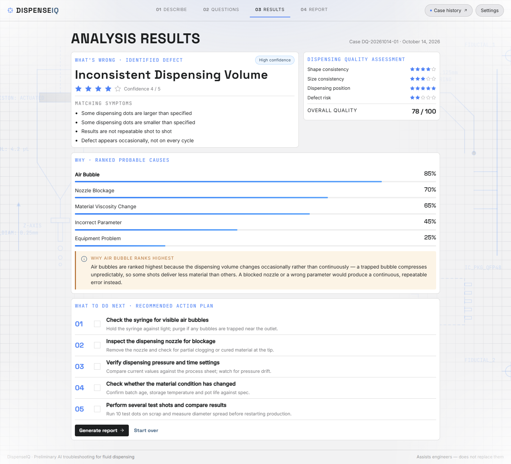
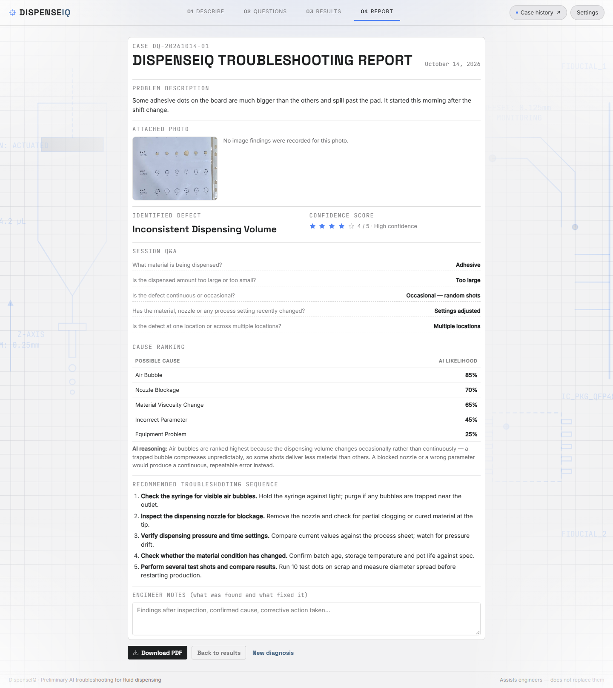

# DispenseIQ — AI Troubleshooting Assistant for Manufacturing Defects

**DispenseIQ helps factory engineers figure out why a dispensing machine is
producing bad parts, in minutes rather than hours of trial and error.**

Built for the **AI Horizon Solution Challenge 2026** (NSW Automation).



---

## At a glance

| | |
|---|---|
| **What it is** | A web app that diagnoses defects in fluid-dispensing machines (the robots that put precise dots of glue, solder paste or sealant onto circuit boards) |
| **Who it's for** | Production-line operators and process engineers |
| **How it works** | The user describes the problem and can attach a photo, then answers five guided questions. The AI names the defect, ranks the likely causes and explains why, gives a step-by-step fix plan, and produces a printable report |
| **The AI** | Google Gemini, grounded in a database of past confirmed cases (retrieval-augmented generation, or RAG), so answers are based on real history rather than guesswork |
| **Measured accuracy** | **93%** correct defect identification on a held-out test set; **100%** of off-topic problems correctly flagged instead of force-fitted |
| **Tech stack** | JavaScript, Node.js, Express, Google Gemini API, Supabase (PostgreSQL + pgvector), Vercel |

---

## The problem

When a dispensing line starts producing faulty dots (too big, too small, missing,
smeared), finding the cause is slow. There are many possible culprits, such as an
air bubble in the syringe, a clogged nozzle, a material batch change or a wrong
pressure setting. Engineers usually work through them by experience and trial and
error, and production waits in the meantime.

## The solution

DispenseIQ guides the engineer through a structured diagnosis, the way an
experienced troubleshooter would.

### 1. Describe the problem, optionally with a photo
The engineer writes what they see in plain language and can upload or take a
photo of the board. The AI inspects the photo for missing, oversized, undersized
or misshapen dots.



### 2. Answer five smart questions
Quick-tap answers narrow down the symptom pattern. The questions adapt to the
answers: for example, "varies shot to shot" triggers a follow-up about when the
variation started.



### 3. Get ranked causes, the reasoning, and an action plan
The app names the defect with a confidence rating, ranks the probable causes by
likelihood, explains in plain English why the top cause ranks highest, and lists
a checkable troubleshooting sequence.



### 4. Generate a report, and teach the system
A one-click PDF report records the whole session for handover or quality records.
The engineer can then confirm or correct the diagnosis, and that confirmed case
is saved to the knowledge base, so **the system gets smarter with every use**.



<sub>Screenshots were captured in the app's built-in Offline Demo Mode, which uses sample data.</sub>

---

## Results

The AI was tested on a labelled evaluation set. The test descriptions were worded
differently from the training data, so the scores measure real understanding
rather than memorised answers.

| Metric | Result |
|---|---|
| Correct defect identified (top answer) | **14 / 15 (93%)** |
| Off-topic problems correctly flagged as "not a dispensing issue" | **3 / 3 (100%)** |
| Planted defects found in test photos | **5 / 5 (100%)** |
| Average confidence, real cases vs off-topic cases | 4.9 / 5 vs 1.3 / 5 |

The confidence gap in the last row matters: the AI is confident when it should be,
and it says when it doesn't know instead of guessing. Full results are in
[eval/results/latest.md](eval/results/latest.md).

---

## Engineering highlights

- **Retrieval-augmented generation (RAG).** Each problem is converted into a vector
  embedding and matched against past cases in a Supabase vector database. The
  closest matches are given to Gemini as evidence, which keeps its answers
  grounded in real history.
- **Knows its limits.** If no past case is similar enough, or the model rates its
  own confidence low, the result is clearly labelled a best-effort guess. This
  guards against confident-sounding wrong answers.
- **Structured, reliable output.** Gemini must answer in a strict, typed JSON
  schema, so the interface never breaks on a malformed AI reply.
- **Computer vision.** Uploaded photos are analysed for five types of dot defect.
  The repo includes a printable target sheet
  ([demo/target-sheet-a4.pdf](demo/target-sheet-a4.pdf)) that makes size defects
  measurable from a single photo.
- **Continuous learning loop.** Confirmed diagnoses are written back to the
  knowledge base and used for the very next diagnosis.
- **Automated evaluation harness.** One command (`npm run eval`) re-scores accuracy,
  out-of-scope detection, confidence calibration and image recall, so every change
  to the prompt or data can be measured.
- **Production care.** API keys stay server-side, the database uses row-level
  security (read-only for the public), the API is rate-limited to cap AI spend,
  and the frontend has no build step.

### Architecture

```
Browser (index.html + app.js)
        │  describe problem + photo + answers
        ▼
Express API (server.js)
        ├─► Gemini embeddings ──► Supabase vector search (similar past cases)
        └─► Gemini (structured JSON) ──► diagnosis back to the browser
        POST /api/confirm ──► confirmed case saved to the knowledge base
        GET  /api/cases   ──► case history screen
```

---

## Run it locally

Requires Node.js 18+, a [Supabase](https://supabase.com) project and a
[Google Gemini API key](https://aistudio.google.com/).

```bash
npm install
```

Create a `.env` file in the project root:

```
GEMINI_API_KEY=your_google_gemini_api_key
SUPABASE_URL=https://your-project.supabase.co
SUPABASE_KEY=your_supabase_publishable_key
SUPABASE_SERVICE_KEY=your_supabase_service_role_key   # server-side only
PORT=8080
```

```bash
npm run seed   # one time: load sample defect cases into Supabase
npm run dev    # start the app at http://localhost:8080
```

> **No API keys?** Open **Settings → Offline Demo Mode** to explore the full flow
> with sample data.

<details>
<summary><strong>More technical detail (project structure, evaluation, settings)</strong></summary>

### Project structure

| Path | Purpose |
|---|---|
| `index.html`, `styles.css`, `app.js` | Single-page frontend: screens, question flow, results and report |
| `server.js` | Express backend: `/api/analyze` (rate-limited), `/api/confirm`, `/api/cases` |
| `lib/analyze.js` | The RAG pipeline (embed → vector search → Gemini structured output), shared by the server and the eval harness |
| `scripts/seedDatabase.js` | Loads the sample defect dataset with embeddings |
| `eval/` | Labelled test cases (`cases.js`), runner (`run.js`) and saved results |
| `supabase/` | Row-level security policy and learning-loop schema migration |
| `demo/` | Printable target sheet for the hands-on photo demo |
| `design/` | Original design source the UI was built from |

### Evaluation

```bash
npm run eval                          # all labelled cases
npm run eval -- --only vol,oos-cold   # a subset
npm run eval -- --tag my-change       # label the saved results
```

Results are written to `eval/results/<timestamp>-<tag>.{json,md}`. Each case costs
one Gemini call, so on the free tier run the full set sparingly.

### Learning loop setup

Saving confirmed cases requires `SUPABASE_SERVICE_KEY` on the server; the browser
never sees it. Run `supabase/learning_loop.sql` once in the Supabase SQL Editor to
add the `created_at`, `source`, `material` and `case_ref` columns.

### In-app settings

- **Analysis mode:** Live AI, or Offline Demo Mode (instant sample data for presentations)
- **AI strictness:** Standard, or Strict quality control
- **Theme:** Light or Dark

### Challenge criteria coverage

| Challenge requirement | Where it's met |
|---|---|
| Step 1: Problem discovery | Five guided questions with quick answers or free text |
| Step 2: Identify the defect | Named defect, confidence stars, matching symptoms, low-confidence flag |
| Steps 3–4: Cause analysis and scoring | Ranked causes with likelihoods, evidence for and against each, written reasoning |
| Step 5: Action plan | Checkable troubleshooting sequence generated per case |
| Bonus: Dynamic questions | Follow-up question inserted on "varies shot to shot" |
| Bonus: Image recognition | Photo analysis for missing, oversized, undersized, irregular and spreading dots |
| Bonus: Learning database | Vector search over confirmed cases, plus engineer confirm/correct loop |
| Bonus: PDF report | Print-ready report with engineer notes |

</details>
